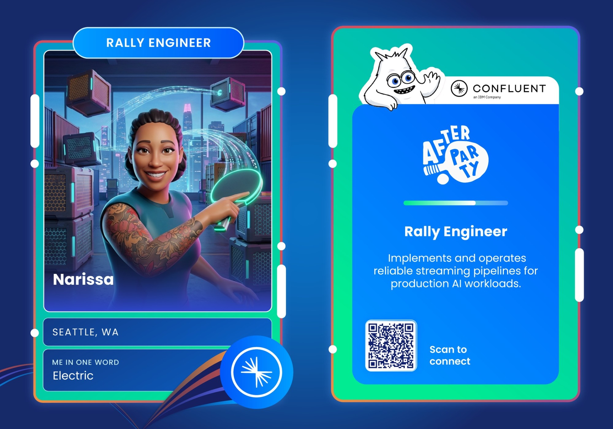

I'm a lifelong learner and software engineer with a special love for data infrastructure. As of late, I've been especially interested in Kafka and Postgres. But I'm taking a night course on Flink via UCSD Extension and I've also taken up learning Spark at a deeper level past the Databricks abstractions I'm comfortable with.

Before software I spent five years in construction, as a project engineer and preconstruction manager. Commercial construction taught me how to tackle complex engineering problems in a high-stress work environment. Most of all, it taught me how to anticipate and prevent critical breakdowns in expensive systems (steel, concrete, geo, plumbing, mechanical, electrical). It made me a sharp and tough person. Then I went back to school for a CS certificate and a Master’s at Seattle University while working full-time. 

In my free time I mentor sophomores at Seattle University, I teach myself new things, and go to meetups. I love learning and sharing what I've learned with others. 

If anything about me or this site resonates with you or you want to connect, feel free to reach out.
